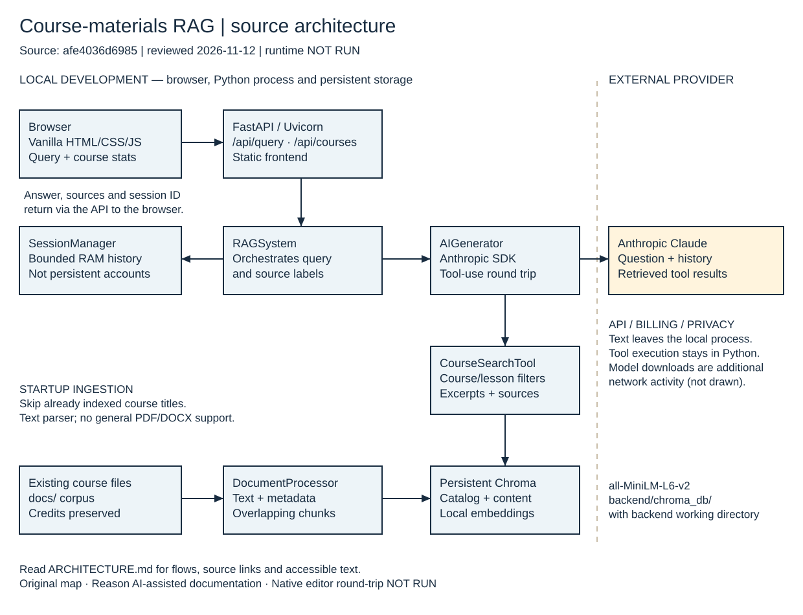

# Course-materials RAG architecture

[Editable Excalidraw source](architecture.excalidraw) ·
[Static SVG preview](architecture.svg) · [Accessible HTML view](architecture.html) ·
[Setup notes](SETUP.md)

This original map documents the implementation at
[`afe4036d698535d75cacc7f2454cd153d028ac4d`](https://github.com/JDKristenson/starting-ragchatbot-codebase/tree/afe4036d698535d75cacc7f2454cd153d028ac4d),
reviewed 2026-11-12. It is a source-derived design view, not a running-system
capture, ownership claim or reproduction of a course diagram.

## Accessible text alternative

The map has a local-development region and a separate external-provider region.
Arrows describe these flows:

1. **Browser → FastAPI:** the vanilla frontend submits a question and optional
   session identifier to `POST /api/query`, and reads `GET /api/courses` for
   catalog statistics. FastAPI serves the frontend static files. The response
   includes answer text, source labels and a session identifier.
2. **FastAPI → RAGSystem:** the orchestrator coordinates generation, local search
   and conversation history. `SessionManager` holds bounded exchanges in process
   memory; they are lost when the process ends.
3. **Course files → DocumentProcessor → Chroma:** on startup the app scans the
   existing `docs/` corpus. The processor reads text, extracts course/lesson
   metadata, and makes overlapping chunks. The store writes catalog and content
   collections; sentence-transformer embeddings use `all-MiniLM-L6-v2`.
   The documented backend working directory places storage at
   `backend/chroma_db/`. Acquisition of model assets may need network access.
4. **RAGSystem → AIGenerator → Anthropic:** the generator sends the question,
   available history and tool definitions to the configured Claude model. This
   is an external API/billing/privacy boundary, not local-only inference.
5. **AIGenerator → CourseSearchTool → Chroma:** if Claude requests a tool, Python
   executes local semantic search, optionally filtered by course/lesson. The
   tool formats retrieved excerpts and tracks source labels. Tool results are
   sent to Anthropic in a follow-up generation call. The map's external arrow
   summarizes both API directions; provider text does not execute a remote
   Python tool directly.
6. **Answer return:** AIGenerator returns text through RAGSystem and FastAPI to
   the browser; source labels accompany the response. The orchestrator updates
   the in-memory conversation history.

The diagram omits incidental frontend CDN traffic and dependency/model downloads
from the main query flow; those are additional external boundaries documented in
[setup](SETUP.md). It does not imply authentication, production isolation, a
native desktop shell, an MCP server or a MongoDB integration.

## Source anchors

- [Server, routes, startup and static mount](../backend/app.py)
- [Orchestration and ingestion](../backend/rag_system.py)
- [Document reader and chunking](../backend/document_processor.py)
- [Persistent Chroma collections and embedding function](../backend/vector_store.py)
- [Search tool definitions/results](../backend/search_tools.py)
- [Provider calls and tool-use follow-up](../backend/ai_generator.py)
- [Process-memory sessions](../backend/session_manager.py)
- [Configuration and relative storage path](../backend/config.py)
- [Browser client](../frontend/script.js)

## Editing and validation limits

Import `architecture.excalidraw` into a trusted Excalidraw editor as a local file.
Shapes, labels and arrows are ordinary editable elements, not an embedded image.
Preserve credits and avoid adding credentials or private corpus excerpts. Update
this text and the SVG whenever the drawing changes; the SVG is a static companion,
not automatically synchronized by the application.

Validation for this change covers JSON structure, unique element IDs, arrow
geometry, SVG XML, local documentation links and a visible rendering of the SVG
companion. **Native Excalidraw import/edit/save/reopen round-trip was NOT RUN.**
The SVG and Excalidraw share geometry, but a readable SVG does not prove native
editor fidelity. No app, model, provider request, install, build or runtime test
was run.
